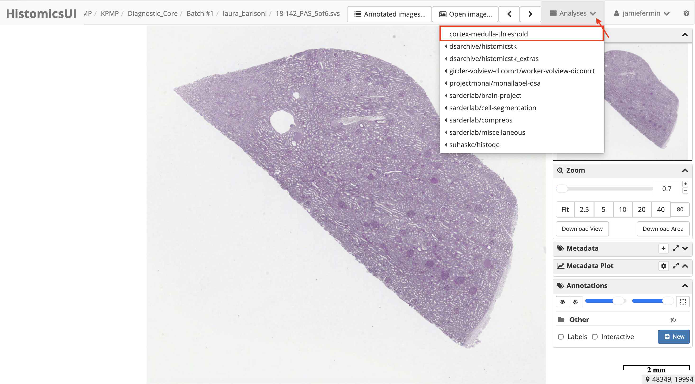
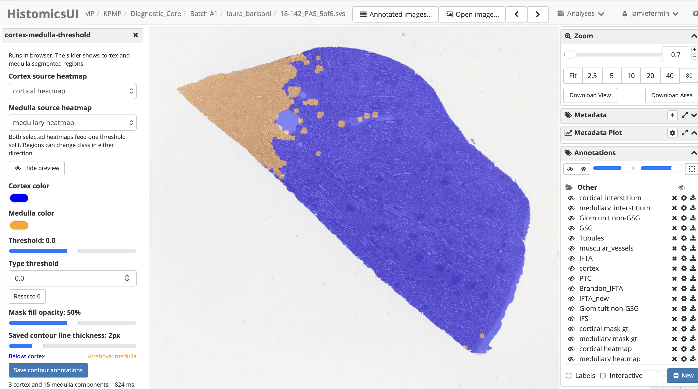
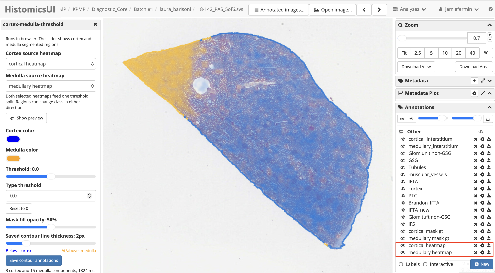
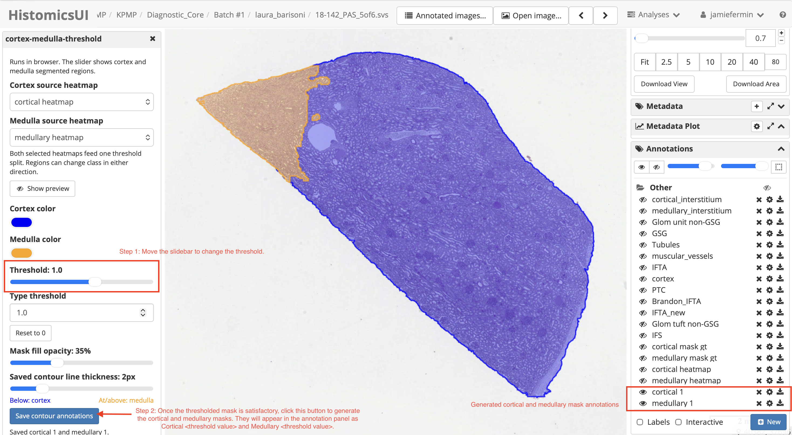

# Cortex–Medulla Threshold

A HistomicsUI plugin for cortex–medulla QC segmentation. It uses cortical and medullary heatmap annotations to preview a threshold-based split, then saves the resulting cortex and medulla regions as mask annotations. Processing runs in the browser.

## Configure DSA provisioning

In the DSA deployment's `provision.yaml`, add these top-level settings, merging them with the existing configuration:

```yaml
pip:
  - "--upgrade git+https://github.com/UFerminJamie/cortex-medulla-threshold.git@main"
rebuild-client: True
```

For a pinned deployment, replace `main` with the plugin commit SHA. `rebuild-client: True` builds the HistomicsUI client with the plugin installed.

## Recreate Girder to install the plugin

From the DSA Compose directory, recreate the Girder service:

```bash
DSA_USER="$(id -u):$(id -g)" docker compose up -d --force-recreate girder
docker compose logs -f girder
```

Wait for provisioning and the client build to finish, then open a slide in HistomicsUI.

## Use the plugin

1. In HistomicsUI, open **Analyses → cortex-medulla-threshold**.

   

2. Select the cortical and medullary source heatmaps and show the preview.

   

   The preview displays cortex and medulla regions over the slide.

   

3. Adjust the threshold until the preview is suitable, then choose **Save contour annotations**. The plugin creates cortex and medulla mask annotations.

   

4. View the saved masks in the HistomicsUI **Annotations** panel. Use the visibility controls to inspect the masks over the slide.
